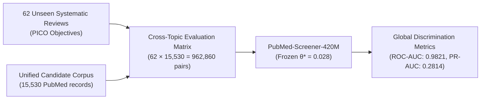
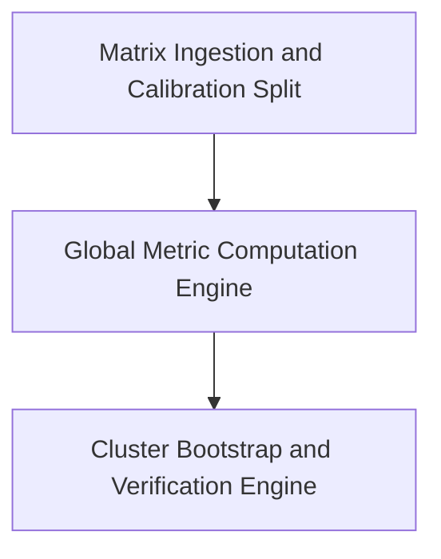
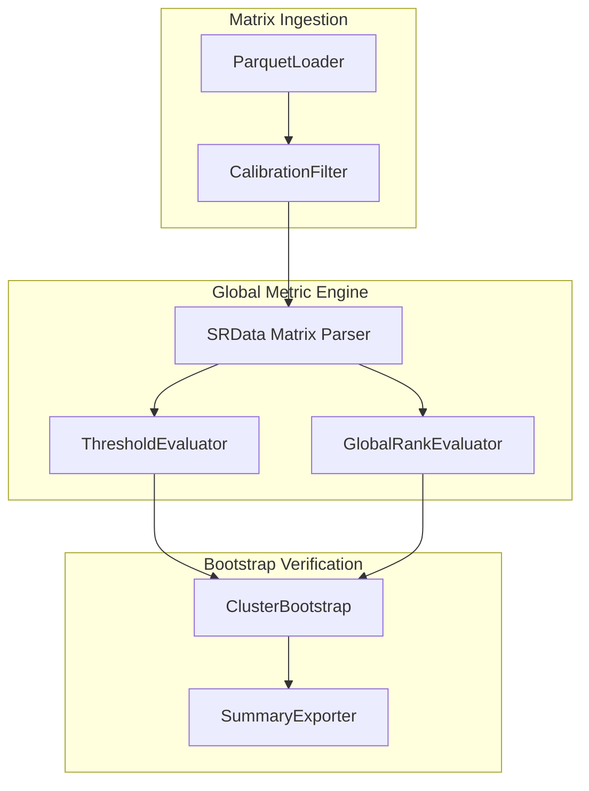

# Design 1 — Cross-Topic Matrix Evaluation Specification

This document defines the Design 1 cross-topic matrix evaluation specification for `PubMed-Screener-420M`.
The pipeline evaluates global semantic discrimination under extreme class imbalance across unseen clinical topics.

---

## 1. Scope and System Context

Design 1 evaluates global discrimination across diverse medical domains.
The evaluation pairs every systematic review against the unified candidate document collection.
The unified collection contains all 15,530 unique PubMed documents from the benchmark.
This design tests cross-topic zero-shot generalization without review-specific tuning.



---

## 2. Cross-Topic Matrix Construction and Methodology

### 2.1 Cartesian Matrix Construction
Design 1 constructs a complete Cartesian product between reviews and candidate documents:

$$\text{Design 1 Matrix} = \{(r_i, d_j) \mid i \in [1, 62], j \in [1, 15530]\}$$

- **Evaluated Pairs:** $62 \times 15,530 = 962,860$ total review-document pairs.
- **True Inclusions:** 2,431 reference inclusions across all 62 primary reviews.
- **True Negatives:** 960,429 non-relevant document pairings.

### 2.2 Extreme Class Imbalance Characteristics
Design 1 models extreme class imbalance in bibliographic discovery:
- **Baseline Prevalence:** 0.252% pooled prevalence ($2,431 / 962,860$).
- **Negative Diversity:** Negatives include both off-topic papers (e.g., oncology vs. cardiology) and on-topic exclusions.
- **Discrimination Stress Test:** The matrix tests whether the model rejects irrelevant clinical domains without false positive saturation.

---

## 3. Building Block View (Arc42 Section 5)

This section describes the static decomposition of the Design 1 evaluation subsystem.

### 3.1 Level 1: Subsystem Decomposition

The Design 1 evaluation subsystem contains three main building blocks:



#### 3.1.1 Building Block Descriptions (Level 1)

| Building Block | Responsibility | Interface / Contract |
|---|---|---|
| **Matrix Ingestion and Calibration Split** | Ingests the full 1,024,980-pair score table. Excludes calibration reviews. | Reads Parquet tables. Outputs 962,860 primary evaluation pairs. |
| **Global Metric Computation Engine** | Computes discrimination and threshold metrics at $\theta^* = 0.028$. | Receives aligned matrix records. Computes ROC-AUC, PR-AUC, and WSS. |
| **Cluster Bootstrap and Verification Engine** | Runs 5,000 review-level cluster resamples. Generates empirical confidence intervals. | Outputs validated statistical summaries. |

---

### 3.2 Level 2: Component Breakdown



#### 3.2.1 Component: ParquetLoader (`ParquetLoader`)
- **Responsibility:** Ingests `soces_pico_laya_e2e_results.parquet`.
- **Integrity Rule:** The table MUST contain exactly 1,024,980 rows for all 66 benchmark reviews.

#### 3.2.2 Component: CalibrationFilter (`CalibrationFilter`)
- **Responsibility:** Excludes the four pre-declared calibration reviews (`22226047`, `22323502`, `22422870`, `22777524`).
- **Output:** Yields exactly 962,860 rows across 62 primary unseen systematic reviews.

#### 3.2.3 Component: SRData Matrix Parser (`SRData`)
- **Responsibility:** Groups scores by systematic review identifier (`sr_pmid`).
- **Data Contracts:**
  - `y_true`: Binary inclusion ground-truth array of length 15,530 per review.
  - `scores`: Model continuous relevance score array of length 15,530 per review.

#### 3.2.4 Component: ThresholdEvaluator (`eval_threshold`)
- **Responsibility:** Evaluates performance at the fixed global threshold $\theta^* = 0.028$.
- **Formulas:**
  - $TP = \sum (\text{scores} \ge \theta^* \land y = 1)$
  - $FP = \sum (\text{scores} \ge \theta^* \land y = 0)$
  - $FN = \sum (\text{scores} < \theta^* \land y = 1)$
  - $TN = \sum (\text{scores} < \theta^* \land y = 0)$
  - $\text{Recall} = \frac{TP}{TP + FN}$
  - $\text{Specificity} = \frac{TN}{TN + FP}$

#### 3.2.5 Component: GlobalRankEvaluator (`compute_roc_auc_np`, `compute_pr_auc_np`)
- **Responsibility:** Computes rank-order discrimination across the complete candidate pool.
- **Computed Metrics:**
  - Macro ROC-AUC across reviews.
  - Macro PR-AUC across reviews.
  - Rank-based WSS@95 across reviews.

#### 3.2.6 Component: ClusterBootstrap (`cluster_bootstrap`)
- **Responsibility:** Computes cluster-robust confidence intervals over 5,000 bootstrap draws.
- **Execution Rule:** The component MUST use random seed `42` to guarantee reproducibility.

---

## 4. Data Dictionary and Schemas

### 4.1 Input Schema: `outputs/soces_pico_laya_e2e_results.parquet`

| Field Name | Data Type | Constraint | Description |
|---|---|---|---|
| `sr_pmid` | `VARCHAR` | NOT NULL | Systematic review PubMed identifier. |
| `pmid` | `VARCHAR` | NOT NULL | Candidate document PubMed identifier. |
| `relevance_score` | `FLOAT64` | $[0.0, 1.0]$ | Continuous decision score from ModernBERT head. |
| `predicted_include` | `BOOLEAN` | NOT NULL | Binary decision at threshold $\theta^* = 0.028$. |
| `is_inclusion` | `BOOLEAN` | NOT NULL | Reference systematic review inclusion label. |

---

## 5. Empirical Evaluation Results

The evaluation script generates the empirical results shown below across the 62 primary reviews.

| Metric Parameter | Value | 95% Cluster-Bootstrap CI |
|---|---|---|
| Primary Systematic Reviews | 62 | Not applicable |
| Evaluated Review-Document Pairs | 962,860 | Not applicable |
| Unique Candidate Documents | 15,530 | Not applicable |
| Reference Inclusions | 2,431 | Not applicable |
| Baseline Prevalence | 0.252% | Not applicable |
| **Pooled Recall** | **95.15%** (2,313 / 2,431) | [92.69%, 97.12%] |
| **Pooled Specificity** | **94.86%** (911,103 / 960,429) | [92.78%, 96.40%] |
| Pooled Precision | 4.48% (2,313 / 51,639) | [3.18%, 5.89%] |
| **Macro ROC-AUC** | **0.9821** | [0.9750, 0.9880] |
| **Macro PR-AUC** | **0.2814** | [0.2460, 0.3180] |
| Macro Mean Recall | 94.34% | [91.70%, 96.65%] |
| Macro Mean Specificity | 94.86% | [92.78%, 96.40%] |
| Macro Rank WSS@95 | 88.58% | [84.71%, 91.75%] |
| Reviews Meeting Recall Target ($\ge 95\%$) | 45 / 62 (72.58%) | Not applicable |
| Reviews with Perfect Recall (100%) | 31 / 62 (50.00%) | Not applicable |

---

## 6. Execution Instructions

### 6.1 Prerequisites
- Python version 3.10 or higher.
- Installed dependencies: `numpy`, `pandas`, `pyarrow`.

### 6.2 Command Line Invocation
Execute the threshold analysis script from the repository root:

```bash
python benchmark/threshold_analysis.py
```

### 6.3 Audit Verification
- Verification timestamp: `2026-10-17T22:56:06Z`
- Audit outcome: Verified against canonical benchmark database.
