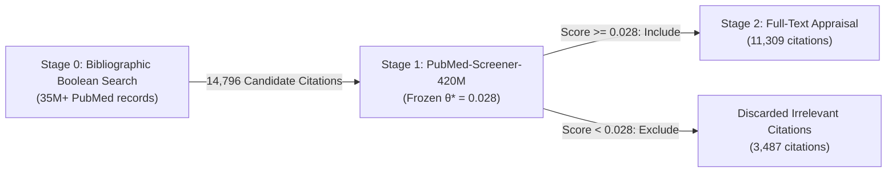
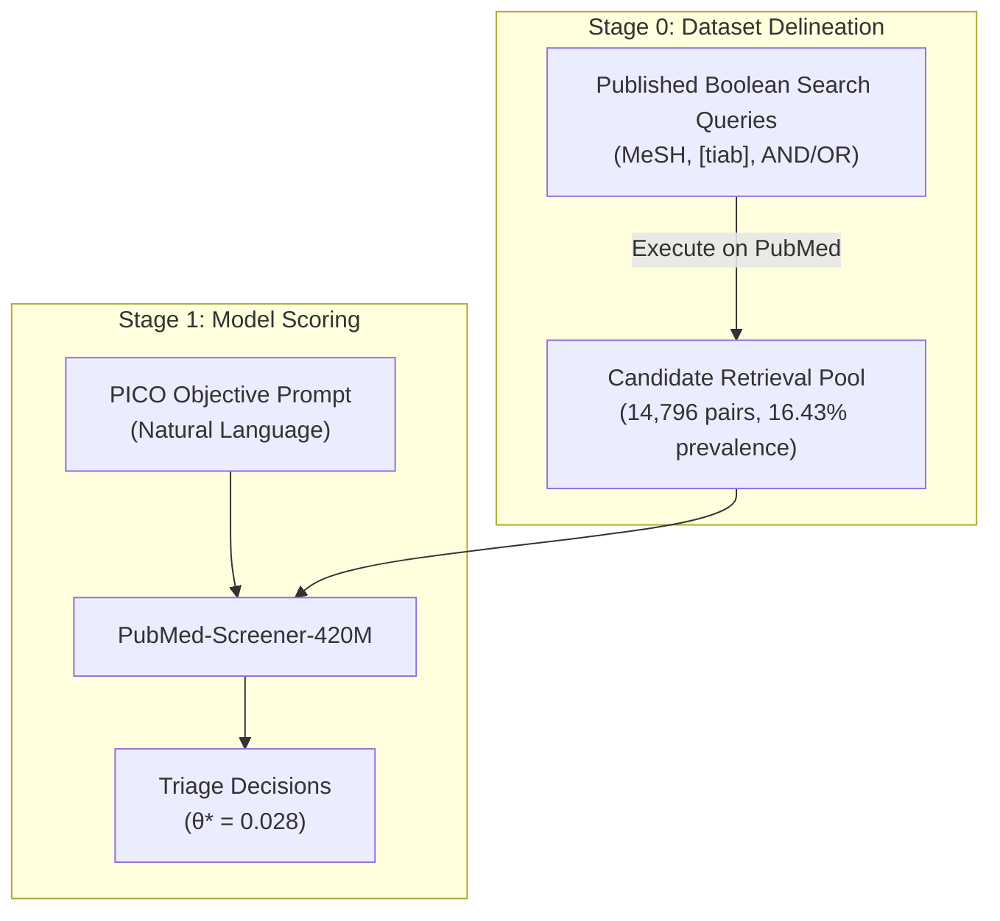
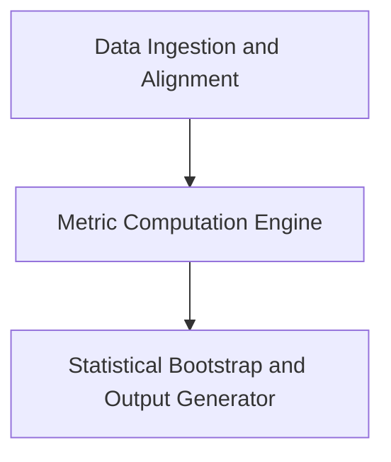
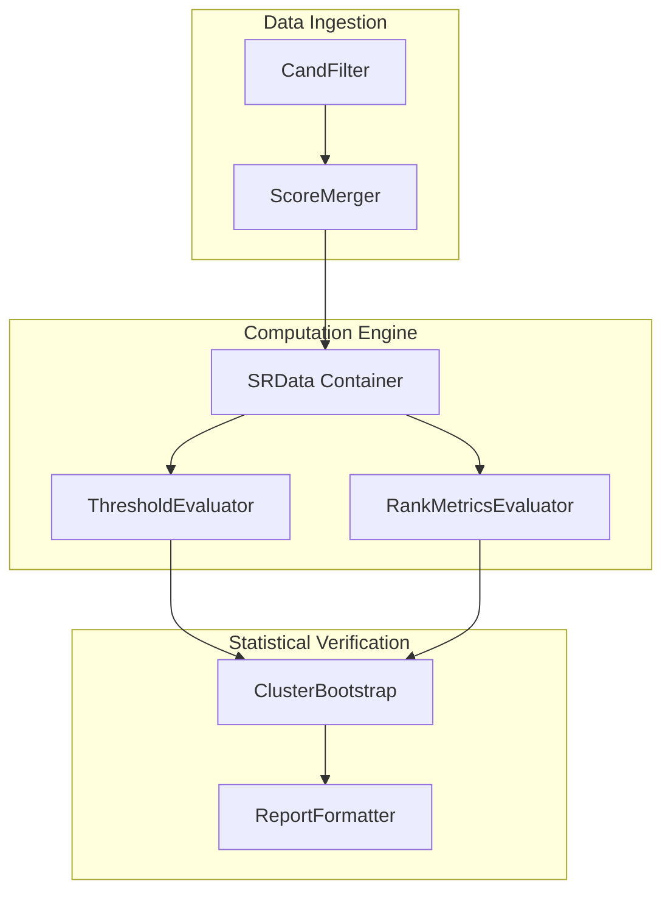

# Design 2 — Boolean-Search Deployment Evaluation Specification

This document defines the Design 2 deployment evaluation specification for `PubMed-Screener-420M`.
The pipeline evaluates Stage-1 citation triage performance on candidate citations from bibliographic Boolean searches.

---

## 1. Scope and System Context

The system operates as a Stage-1 triage filter.
The model does NOT replace Stage 0 bibliographic Boolean retrieval.
The model does NOT replace Stage-2 full-text clinical synthesis.
Stage 0 Boolean searches retrieve a broad candidate pool from PubMed.
The model filters this candidate pool before reviewers conduct Stage-2 full-text appraisal.



---

## 2. Bibliographic Search Definition and Retrieval Provenance

### 2.1 Definition of Bibliographic Boolean Searches
Bibliographic Boolean searches represent expert search strings from published systematic reviews.
Information specialists author these search strings to maximize retrieval sensitivity.
Each search string combines three components:
1. Controlled vocabulary terms using Medical Subject Headings (`[MeSH]`).
2. Free-text title and abstract keywords (`[tiab]`) with truncation wildcards.
3. Boolean operators (`AND`, `OR`, `NOT`) and methodological study design filters.

### 2.2 Search Query Provenance
The evaluation corpus uses benchmark data from Bentegeac et al. (2026).
The benchmark compiles published search strategies from 62 unseen primary systematic reviews.
These published queries retrieved 14,796 candidate review-document pairs.
The candidate pool contains 14,382 unique PubMed records and 2,431 reference inclusions.

### 2.3 Distinction: Dataset Construction vs. Model Inference
The pipeline separates candidate retrieval from neural model inference.



1. **Stage 0 (Dataset Delineation):**
   - The Boolean keywords determine which records enter the candidate pool.
   - The Boolean search operates over all PubMed records.
2. **Stage 1 (Model Scoring):**
   - The model does NOT take Boolean search syntax as input.
   - The model receives a natural language PICO question.
   - The model scores the candidate title and abstract text.

---

## 3. Methodological Rationale and Comparative Baseline

### 3.1 Downstream Deployment Baseline
Design 2 evaluates the model as a secondary semantic filter.
The baseline is manual screening of all 14,796 Boolean search results.
The model does NOT compete against Boolean retrieval.
The model operates directly on the output of Boolean retrieval.

### 3.2 Workload and Safety Analysis
- **Screening Workload:** The model reduces human screening volume from 14,796 citations to 11,309 citations.
- **Noise Elimination:** The model eliminates 3,487 irrelevant citations (28.20% specificity).
- **Safety Standard:** The model retains 2,313 of 2,431 reference inclusions (95.15% pooled recall).
- **Threshold Integrity:** The model applies a single frozen threshold $\theta^* = 0.028$ to all reviews.

---

## 4. Building Block View (Arc42 Section 5)

This section describes the static decomposition of the Design 2 evaluation subsystem.

### 4.1 Level 1: Subsystem Decomposition

The Design 2 evaluation subsystem contains three main building blocks:



#### 4.1.1 Building Block Descriptions (Level 1)

| Building Block | Responsibility | Interface / Contract |
|---|---|---|
| **Data Ingestion and Alignment** | Ingests candidate mappings and inference score tables. Filters out calibration reviews. | Reads Parquet tables. Returns aligned evaluation pairs. |
| **Metric Computation Engine** | Computes Stage-1 triage metrics at fixed threshold $\theta^* = 0.028$. | Receives aligned records. Outputs confusion matrices and rank metrics. |
| **Statistical Bootstrap and Output Generator** | Executes 5,000 cluster-bootstrap iterations. Exports tabular summary artifacts. | Writes JSON and CSV artifacts to disk. |

---

### 4.2 Level 2: Component Breakdown



#### 4.2.1 Component: CandFilter (`CandFilter`)
- **Responsibility:** Ingests `benchmark_candidates.parquet`.
- **Filtering Rules:**
  - The component MUST exclude calibration reviews (`22226047`, `22323502`, `22422870`, `22777524`).
  - The component MUST exclude reviews with `excluded_from_study == True`.
  - The component MUST extract columns `sr_pmid`, `pmid`, and `is_inclusion`.

#### 4.2.2 Component: ScoreMerger (`ScoreMerger`)
- **Responsibility:** Merges candidate pairs with `soces_pico_laya_e2e_results.parquet`.
- **Integrity Constraints:**
  - Every candidate pair MUST contain a valid `relevance_score`.
  - Reference labels between candidate tables and score tables MUST match exactly.

#### 4.2.3 Component: SRData Container (`SRData`)
- **Responsibility:** Stores ground-truth inclusion flags and model relevance scores for one systematic review.
- **Data Contracts:**
  - `y_true`: Array of binary integers (`0` or `1`).
  - `scores`: Array of floating-point decision scores in range `[0.0, 1.0]`.

#### 4.2.4 Component: ThresholdEvaluator (`eval_threshold`)
- **Responsibility:** Applies global decision threshold $\theta^* = 0.028$.
- **Formulas:**
  - $TP = \sum (\text{scores} \ge \theta^* \land y = 1)$
  - $FP = \sum (\text{scores} \ge \theta^* \land y = 0)$
  - $FN = \sum (\text{scores} < \theta^* \land y = 1)$
  - $TN = \sum (\text{scores} < \theta^* \land y = 0)$
  - $\text{Recall} = \frac{TP}{TP + FN}$
  - $\text{Specificity} = \frac{TN}{TN + FP}$
  - $\text{Workload} = \frac{TP + FP}{N}$

#### 4.2.5 Component: RankMetricsEvaluator (`compute_pr_auc_np`, `compute_roc_auc_np`)
- **Responsibility:** Calculates threshold-independent discrimination metrics.
- **Computed Metrics:**
  - Area Under the Precision-Recall Curve (PR-AUC).
  - Area Under the Receiver Operating Characteristic (ROC-AUC).
  - Work Saved over Sampling at 95% Recall (WSS@95).

#### 4.2.6 Component: ClusterBootstrap (`cluster_bootstrap`)
- **Responsibility:** Performs non-parametric review-level cluster bootstrapping.
- **Execution Parameters:**
  - Resampling unit: Systematic review cluster (`sr_pmid`).
  - Iteration count: 5,000 resamples.
  - Random seed: MUST use seed `42` for exact reproducibility.
  - Confidence interval: 2.5th and 97.5th percentiles (95% CI).

---

## 5. Data Dictionary and Schemas

### 5.1 Input Data Contracts

#### Input 1: `benchmark/benchmark_candidates.parquet`
| Field Name | Type | Description |
|---|---|---|
| `sr_pmid` | `VARCHAR` | PubMed identifier of the systematic review. |
| `pmid` | `VARCHAR` | PubMed identifier of candidate article. |
| `is_inclusion` | `BOOLEAN` | Ground truth inclusion label. |
| `excluded_from_study` | `BOOLEAN` | Exclusion flag for benchmark integrity. |

#### Input 2: `outputs/soces_pico_laya_e2e_results.parquet`
| Field Name | Type | Description |
|---|---|---|
| `sr_pmid` | `VARCHAR` | Systematic review identifier. |
| `pmid` | `VARCHAR` | Candidate citation identifier. |
| `relevance_score` | `FLOAT64` | Continuous model score in range `[0.0, 1.0]`. |
| `predicted_include` | `BOOLEAN` | Binary decision at threshold $\theta^* = 0.028$. |
| `is_inclusion` | `BOOLEAN` | Ground truth reference label. |

---

## 6. Empirical Evaluation Results

The evaluation script generates the empirical results shown below across 62 primary systematic reviews.

| Metric Parameter | Value | 95% Bootstrap CI |
|---|---|---|
| Systematic Reviews | 62 | Not applicable |
| Evaluated Candidate Pairs | 14,796 | Not applicable |
| Unique PubMed Records | 14,382 | Not applicable |
| Total Inclusions | 2,431 | Not applicable |
| Pooled Prevalence | 16.43% | Not applicable |
| Mean Per-Review Prevalence | 15.45% | Not applicable |
| Pooled Recall | 95.15% (2,313 / 2,431) | [92.69%, 97.12%] |
| Pooled Specificity | 28.20% (3,487 / 12,365) | [22.90%, 33.32%] |
| Macro Mean Workload | 77.62% | Not applicable |
| Macro PR-AUC | 0.3530 | [0.3228, 0.3829] |
| Macro ROC-AUC | 0.7361 | [0.7122, 0.7593] |
| Macro Rank WSS@95 | 26.65% | [23.01%, 30.38%] |
| Macro Threshold WSS | 16.33% | [13.62%, 19.11%] |
| Reviews with Recall $\ge 95\%$ | 45 / 62 (72.58%) | Not applicable |
| Reviews with Recall = 100% | 31 / 62 (50.00%) | Not applicable |

---

## 7. Execution Instructions

### 7.1 Prerequisites
- Python version 3.10 or higher.
- Installed dependencies: `numpy`, `pandas`, `pyarrow`.

### 7.2 Command Line Invocation
Execute the analysis script from the repository root:

```bash
python benchmark/design2_and_supplementary_analysis.py
```

### 7.3 Output Artifacts
The execution MUST write the following output files:
- `publication/tables/phase1_summary.json` (Structured JSON containing all Design 2 parameters).
- `publication/tables/per_review_recall.csv` (Per-review recall breakdown for all 62 primary reviews).

### 7.4 Audit Verification
- Verification timestamp: `2026-10-17T22:56:06Z`
- Audit outcome: Verified against canonical benchmark database.
